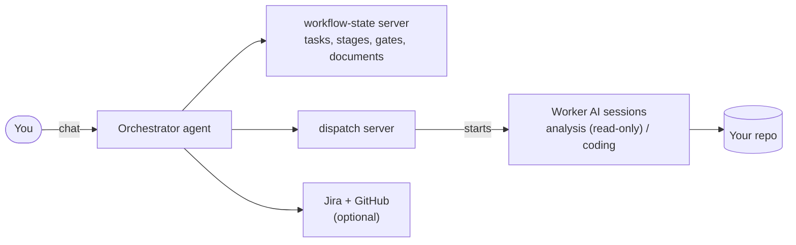
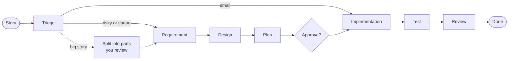

# AI-Assisted SDLC Orchestrator

Turn a Jira ticket or a plain description into reviewed, tested code, with an AI that **manages the process** and separate AI sessions that **do the work**. You chat with an orchestrator agent in GitHub Copilot CLI, Claude Code or Cursor. It decides how much process a story needs, drives it through **requirement → design → plan → implementation → test → review**, stops for your approval on risky plans, and remembers where everything stands. It can also work through a queue of tasks while you are away ([autonomous mode](docs/autonomous-mode.md)).

## How it works





1. **Triage, right-sized.** The orchestrator rates the story. A small, reversible change goes straight to coding; a risky or vague one pays for requirement, design and plan first. A big story is split into parts you review before anything is created.
2. **Analysis in fresh sessions.** Each stage runs as a new read-only worker session and writes a Markdown document you can read and edit. Stages hand over through those documents, not chat history, so cost per step does not grow with the story.
3. **You decide the risky parts.** You answer open questions and confirm documents, and a risky plan stops at an approval gate that the server enforces. Every reply ends with numbered options.
4. **Coding on its own branch.** Implementation is a coding session on `story/<id>`, never `main`; optionally tests are written first and frozen, and the server flags changes outside the plan. Nothing is written into your repos otherwise.
5. **Test, review, merge.** Tests run and failures retry a few times, then it goes to review. You merge.

The orchestrator itself stays small: all state lives in the `workflow-state` server, so you can open a new chat any time and say `continue 2` or `resume PROJ-123`. Gates, read-only analysis, frozen tests and the scope check are enforced by the servers, not requested in a prompt. The same skills run on Copilot CLI, Claude Code, Cursor or a custom command. More: [workflow.md](docs/workflow.md), [architecture.md](docs/architecture.md).

## Quick start

**Needs:** Node 22.5+, Git, a chat tool with MCP support (Copilot CLI, Claude Code or Cursor), and the CLI of the AI that does the dispatched work, installed and signed in (Copilot: `npm install -g @github/copilot`, then run `copilot` once). Jira and GitHub MCP access is optional.

```
# 1. Build (keep this folder where it is: the tools point at it)
npm install
npm run build

# 2. Install the agent and register the servers (add --dry-run first to preview)
#    --repo registers a repo and may be repeated; nothing is written into the repo
node dist/cli/index.js install --target copilot-cli --repo D:/work/ProjectA
node dist/cli/index.js install --target cursor      --repo D:/work/ProjectA
node dist/cli/index.js install --target claude                        # prints the `claude mcp add` commands to run

# 3. Pin the model the dispatched sessions use (see the note below)
node dist/cli/index.js config set default_platform copilot
node dist/cli/index.js config set platforms.copilot.model gpt-6-luna
```

4. Start a **new** chat session so it loads the agent. Select the **orchestrator** agent (Cursor: `@orchestrator-agent`) and say `hi`, then `which repos and AI platforms are set up?`

**The dispatched model is a separate setting.** The orchestrator runs on the model you picked in your chat window. Every stage it dispatches runs in a separate CLI session with its own model and billing. Unpinned, the CLI uses its own default, which may cost more than your chat model. Use the same model as your chat window (`/model` inside `copilot` lists valid names). A wrong name fails at once at no cost. Try the pipeline on one small story first.

## Set up a project

Run from this repo's folder (after `npm link` you can type `sdlc-orchestrator ...` anywhere). Omit `--repo` on `config set` for a global setting. You can also ask the chat agent to do any of this; it uses the same code.

```
# register, list, unregister repos
node dist/cli/index.js repos add D:/work/ProjectA
node dist/cli/index.js repos list
node dist/cli/index.js repos remove D:/work/ProjectA

# what is configured now
node dist/cli/index.js config show --repo D:/work/ProjectA

# which AI does the work (claude | copilot | cursor | a custom id) and with what model
node dist/cli/index.js config set platform copilot --repo D:/work/ProjectA
node dist/cli/index.js config set analysis_platform claude                 # read-only stages on another tool
node dist/cli/index.js config set coding_platform copilot --repo D:/work/ProjectA
node dist/cli/index.js model set gpt-6-luna --repo D:/work/ProjectA        # model for this repo (reset: model reset)

# how tests run
node dist/cli/index.js config set test_command "dotnet test App.sln" --repo D:/work/ProjectA

# run several stories in parallel: each task codes in its own git worktree (off by default)
node dist/cli/index.js config set worktree true --repo D:/work/ProjectA
node dist/cli/index.js config set worktree_setup "npm ci" --repo D:/work/ProjectA   # run once in each new worktree
node dist/cli/index.js config unset worktree --repo D:/work/ProjectA

# checks on coding sessions
node dist/cli/index.js config set tests_first true --repo D:/work/ProjectA          # write and freeze failing tests first
node dist/cli/index.js config set scope_check fail --repo D:/work/ProjectA          # off | warn (default) | fail
node dist/cli/index.js config set scope_allow "package-lock.json,docs/**" --repo D:/work/ProjectA

# branch names (default story/{key}; {key} = Jira key, else task id)
node dist/cli/index.js branch set "feature/{key}" --repo D:/work/ProjectA
node dist/cli/index.js branch show
```

Settings take effect on the next dispatch. Every setting and its meaning: [docs/configuration.md](docs/configuration.md) (worktrees, base branches, workspaces with several repos, independent review, routing).

## Use it

Talk naturally. **Every reply ends with numbered Options** (confirm, revise, show, check status, run tests, cancel...). Answer with the number or the words.

```
Work on D:/work/ProjectA: add retry with backoff to the email sender (needs a schema change)
start jira PROJ-123
what's open?            lists unfinished stories across your registered repos, numbered
continue 2              resumes number 2 (also: resume PROJ-123, a task id or a PR number)
show the plan           prints a stored document
remove 2                asks to confirm; "cancel" keeps the history, "remove" deletes it
```

A big story is split into parts you review before anything is created. A risky plan waits for "approve the plan". If a worker looks stalled the agent says so and offers keep waiting, cancel and retry, or another platform; it never cancels on its own. Tips for cheaper, faster runs: [docs/working-with-the-agent.md](docs/working-with-the-agent.md).

**While you are away.** `autopilot` works the tasks of a repo unattended, takes only the decisions your policy allows (each one logged), parks the rest, and gives you a morning report. Code only ever lands on task branches.

```
node dist/cli/index.js autopilot enable
node dist/cli/index.js autopilot start --repo D:/work/ProjectA --hours 8
node dist/cli/index.js autopilot report
```

Details and limits: [docs/autonomous-mode.md](docs/autonomous-mode.md).

## Command reference

```
install   --target copilot-cli|claude|cursor|all [--repo <path>]... [--mode global|repo] [--platform p] [--dry-run]
          also: --analysis-platform, --coding-platform, --test-command, --no-integrations, --jira-server, --github-server
repos     list | add <path>... | remove <path>...
config    show [--repo p] | set <key> <value> [--repo p] | unset <key> [--repo p] | add-project <p> | remove-project <p>
model     show | set <name> --repo p | reset --repo p
branch    show | set <pattern> [--repo p] | reset [--repo p]
tasks     list | show <task_id|JIRA-KEY|PR#> [--stage plan] | remove <task_id> [--yes] [--with-children]
dispatches usage [--task id] [--days N] | prune [--days N] [--yes]
autopilot enable | disable | start --repo p [--tasks a,b] [--hours N] [--max-dispatches N] | start --resume <run_id> | status | stop | report
evals     check | run [--case name] [--platform p] [--model m] [--repeat N]
knowledge claims | repair | check-module | freshness      (checks of knowledge pages against the code they cite)
```

`node dist/cli/index.js --help` has the full text. Settings keys for `config set`: `platform`, `analysis_platform`, `coding_platform`, `review_platform`, `model`, `branch_pattern`, `test_command`, `tests_first`, `scope_check`, `scope_allow`, `redact_secrets`, `worktree`, `worktree_setup` (per repo, or global without `--repo`); `default_platform`, `dispatch_timeout_minutes`, `dispatch_retention_days`, `platforms.<id>.model` (global only).

What `install` writes (copilot-cli and cursor never modify the repo; `--repo` only updates the orchestrator's config):

| Target | Agent file | MCP servers |
|---|---|---|
| `copilot-cli` | `~/.copilot/agents/orchestrator.agent.md` | `~/.copilot/mcp-config.json` |
| `claude` | `~/.claude/agents/orchestrator.md` | prints `claude mcp add` commands to run |
| `cursor` | `~/.cursor/agents/orchestrator-agent.md` | `~/.cursor/mcp.json` |

Existing MCP config files are merged and backed up as `.bak` (comments in them are not preserved). With `copilot-cli --repo`, the folder is added to Copilot CLI's `trustedFolders` so it can load that folder's `.mcp.json`; review a project's MCP server definitions before trusting it.

**After pulling an update:** `npm run build`, then `node dist/cli/index.js install --target <tool>`, then open a new chat. An existing `policy.json` needs no edit: new fields have defaults.

## Where things are stored

Everything is under `~/.ai-sdlc-orchestrator/` (override with `SDLC_DATA_DIR`): `config.json` (platforms, models, repos), `policy.json` (stages, gates, retry limits, autonomy rules), `workflow.db` (tasks, history, approvals), `artifacts/<task_id>/<stage>.v<N>.md` (the stage documents, editable: the next stage reads your edits), `learnings/` (durable team notes), `dispatches/` (one folder per worker session), `backups/` (daily). Details: [docs/configuration.md](docs/configuration.md#configuration).

## Documentation

| Read this | When |
|---|---|
| [docs/workflow.md](docs/workflow.md) | What happens to a story, step by step, and who does what |
| [docs/configuration.md](docs/configuration.md) | Files, worktrees, base branches, branch names, workspaces, models, review, tests first, scope, wrong specs |
| [docs/autonomous-mode.md](docs/autonomous-mode.md) | Unattended runs: what may be decided, what parks, the morning report |
| [docs/working-with-the-agent.md](docs/working-with-the-agent.md) | Phrasing requests and keeping cost down |
| [docs/security.md](docs/security.md) | Secret redaction, untrusted content, worker restrictions per platform |
| [docs/cost-and-evals.md](docs/cost-and-evals.md) | Token use, task budgets, skill evals |
| [docs/troubleshooting.md](docs/troubleshooting.md) | Symptoms and fixes |
| [docs/features.md](docs/features.md) | Full feature list and the AI practices covered |
| [docs/architecture.md](docs/architecture.md) | Components, code layers, data, how a dispatch works, design decisions |
| [docs/mcp-servers.md](docs/mcp-servers.md) | Every MCP server and tool |
| [docs/knowledge-pipeline.md](docs/knowledge-pipeline.md), [docs/learnings.md](docs/learnings.md) | Project knowledge and durable team notes |
| [clients/README.md](clients/README.md) | Registering the servers by hand (including Claude Desktop) |
| [BACKLOG.md](BACKLOG.md) | What is not done yet |

Agent behaviour lives in [orchestrator-agent/SYSTEM_PROMPT.md](orchestrator-agent/SYSTEM_PROMPT.md), [orchestrator-agent/playbooks/](orchestrator-agent/playbooks/) and [orchestrator-agent/skills/](orchestrator-agent/skills/).

## Development

```
npm run build     # clean and compile to dist/
npm test          # build + run the test suite
```

The source is layered; a module imports only from its own layer or the ones below it ([diagram](docs/architecture.md#code-layers)): **interfaces** (`src/mcp/workflow`, `src/mcp/dispatch`, `src/cli`), **domains** (`src/workflow`, `src/dispatch`, `src/knowledge`, `src/autopilot`, `src/evals`), **stores and settings** (`src/stores`, `src/config`), **shared** (`src/shared`). `orchestrator-agent/` holds the system prompt, playbooks and skills; `docs/architecture.md` is the best starting point for a new contributor.

The Copilot CLI and Cursor adapters have been run against the real CLIs. The Claude Code adapter follows that tool's documented flags but has not been verified against it.
