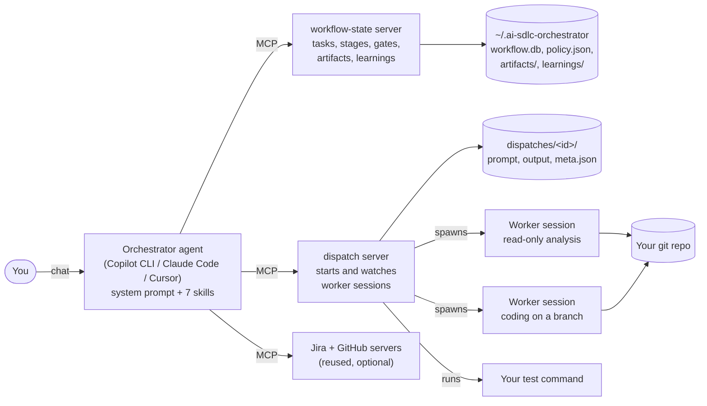
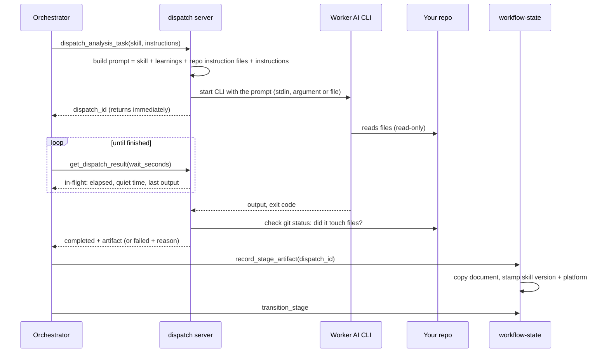

# Architecture

How the pieces fit together, and why. For the story's journey through the pipeline see [workflow.md](workflow.md); for every tool see [mcp-servers.md](mcp-servers.md).

## The idea in one paragraph

A long chat with an AI that both manages a project and does the deep work fills its context and loses the thread. So the work is split in two. A small **orchestrator agent** (the chat you talk to) only decides *what happens next* and keeps a record. Everything heavy, such as reading the repo to write a design or editing code, is **dispatched** to a separate, short-lived AI CLI session. The orchestrator's rules and memory live in a **server with a database**, not in the model's head, so they survive restarts and cannot be forgotten or talked around.

## Overview

| Part | Role | Where |
|---|---|---|
| **Orchestrator agent** | The chat you talk to. Triages, picks the next step, asks you for decisions. Never edits files and never does deep analysis. | [orchestrator-agent/SYSTEM_PROMPT.md](../orchestrator-agent/SYSTEM_PROMPT.md), [skills/](../orchestrator-agent/skills/) |
| **`workflow-state` server** | The single source of truth: tasks, stages, approvals, stage documents, learnings. Enforces the rules (a gate cannot be skipped). | [src/workflow-state/](../src/workflow-state/) |
| **`dispatch` server** | Starts the worker AI CLI, watches it, checks what it did, returns the result. | [src/dispatch/](../src/dispatch/) |
| **Worker sessions** | Separate AI CLI processes (Copilot, Claude, Cursor or custom), one per stage. They do the reading, the writing and the coding. | the CLI you installed |
| **Jira and GitHub servers** | Existing MCP servers, reused: read tickets, find PRs. Optional. | not built here |

The chat tool you host the orchestrator in and the AI that does the dispatched work are **independent choices**: you can talk to it in Copilot CLI while analysis runs on Claude and coding on Cursor.

## Why two servers, and why a database

- **Rules live in code, not in the prompt.** The server refuses an illegal move (for example leaving a gated plan without approval) and says why. The model cannot "decide" its way around it, and a new chat session cannot forget it.
- **Resume anywhere.** Everything about a story is in `workflow.db` and `artifacts/`. A new chat, another tool or another day can pick up with `resume <task>`.
- **Small context.** The orchestrator passes document *ids*, not text. A finished analysis session's document is copied into the task by the server (`record_stage_artifact` with a `dispatch_id`), never pasted through the chat.
- **Tool-neutral.** Nothing in the servers knows which chat tool or worker AI is used; that is configuration.

## Data model

SQLite (`workflow.db`) holds:

| Table | Contents |
|---|---|
| `tasks` | One row per task: repo, title, current stage, triage flags, branch, parent task, in-flight dispatch, `needs_attention` |
| `transitions` | Every stage change with its reason and the policy version (an audit trail) |
| `stage_artifacts` | Metadata for each stage document version (which skill version and platform made it, what it was built from). The document itself is a Markdown file under `artifacts/<task_id>/<stage>.v<N>.md`, so you can read and edit it |
| `approvals` | Who approved which stage and when. A newer version of the document voids an older approval |
| `edge_cases` | Judgement calls made outside the policy, and why |
| `search_fts` | Full-text index over past documents and edge cases, used to find precedent |

Other state on disk, all under `~/.ai-sdlc-orchestrator/` (override with `SDLC_DATA_DIR`):

| Path | Contents |
|---|---|
| `policy.json` | Stages, allowed transitions, approval gates, retry limits. Validated on every edit |
| `config.json` | Which AI platform and model do the work, per-repo overrides, registered repos, timeouts, retention |
| `learnings/` | Durable notes about the team's habits and ticketing quirks, injected into every dispatch |
| `dispatches/<id>/` | One folder per worker session: the prompt, raw output, `meta.json` (status, timings, results). Old ones are pruned automatically |
| `backups/` | Daily copy of the database, learnings and artifacts (newest 14 kept) |

## Anatomy of a dispatch

This is the part that does the real work.

Key points:

- **Always asynchronous.** `dispatch_*` returns a `dispatch_id` straight away; results come only from `get_dispatch_result`. `wait_seconds` (max 55) lets the orchestrator wait without busy-polling.
- **The prompt is built by the server**, not the model: the stage skill (embedded, so every platform runs the same text and gets a content-hash `skill_version`), the repo's own instruction files (`CLAUDE.md`, `.github/agents`, `.cursor/rules`, `AGENTS.md`), and learnings. Prompts over 8,000 characters are handed over as a file to stay under Windows' command-line limit.
- **Three kinds of session:** `analysis` (read-only), `coding` and `test-authoring` (both read and write, on the task branch), plus `test`, which is just your test command run in a shell.
- **Platform adapters** ([platforms.ts](../src/dispatch/platforms.ts)) hide each CLI's flags, how read-only is enforced, and how its output is parsed. A custom CLI can be declared in `config.json` with placeholders.

### What the server checks after a session

These are enforced by the dispatch server, not requested from the AI:

| Check | Applies to | Effect |
|---|---|---|
| **Read-only** | analysis | If `git status` shows new changes in the repo (or any child repo of a workspace), the dispatch fails with `read_only_violation` and its artifact is not trusted |
| **Scope** | coding | The plan's "Files touched" is the allowed scope. Changes outside it are reported (`warn`, default) or fail the dispatch (`fail`) |
| **Frozen tests** | coding | When tests were written first, editing them fails the dispatch; originals are saved aside |
| **Branch** | coding | Work always runs on its own branch, never `main`/`master` |
| **Spec wrong** | coding | The session can report that the plan itself cannot work; the task goes back to an earlier stage instead of being patched around |
| **Timeout** | all | A session past `dispatch_timeout_minutes` is killed (with its child processes) and marked failed |

### Staying healthy

- **Visible while running:** `elapsed_seconds`, `quiet_seconds` and the last printed output (`progress_tail`) are reported, so slow can be told from stuck.
- **Cancellable:** `cancel_dispatch` kills the CLI and everything it started, and records why.
- **Lost process detection:** if the server restarts mid-run, the dispatch is marked failed ("process lost") instead of staying in-flight forever.
- **Double-dispatch guard:** a task with a dispatch in flight cannot start another.
- **Housekeeping:** finished dispatch folders older than `dispatch_retention_days` (default 14) are pruned.

## Policy: rules as data

[`policy.json`](../config/policy.default.json) defines the stage list, which moves are legal, which stages need human approval (and whether only for risky tasks), and retry limits. Edits are validated before they are saved, so a typo fails immediately. Every transition records the policy version it was judged under.

## Multi-repo and workspaces

- **Read other repos:** a task can name `related_repos`; sessions may read them, never write.
- **Split work:** a big or multi-repo story is broken into child tasks, one per independently shippable part and per write target. The parent is the overview; each child has its own branch, tests and PR.
- **Workspace root that is not a git repo:** list its git children as `child_repos`. Analysis runs at the root; implementation runs per child repo.

## Memory

Two kinds, kept separate on purpose (details in [learnings.md](learnings.md)):

- **Learnings:** short notes about the *team* (how requests are phrased, ticketing quirks). Read in full, injected into every dispatch.
- **Precedent search:** full-text search over past stage documents and edge cases, so a new request can find "we decided this before".

Facts about the *codebase* are not stored here. They belong in the repo's own instruction files, and the orchestrator surfaces them to you as suggestions to commit.

## Decisions and when to revisit them

This replaces the old standalone design document. Each line says what was decided and why, and the observable sign that should reopen it.

**Non-goals**

- Not tied to one AI vendor: nothing platform-specific exists outside the adapter layer; the state server, policy, skills and documents are platform-neutral.
- No new chat UI: reuse any MCP-capable client you already have.
- Does not replace a repo's own `.github/agents` or `.github/skills`; those stay as they are and are read as context.
- Jira is not the source of truth for stage. Jira status sync is one-way and best-effort (and off by default); `workflow-state` is authoritative.
- The orchestrator does not read the codebase to do requirement, design or plan reasoning. That is dispatched, so its context stays small whatever the task size.
- It does not try to enumerate every edge case up front. It starts lean, logs judgement calls as edge cases, and grows rules from what actually recurs.

**Decided**

| Decision | Why | Revisit when |
|---|---|---|
| State in SQLite via Node's built-in `node:sqlite` (Node 22.5+) | Transactional, one file, no native packages to install | Several people need one shared orchestrator |
| Stage documents are Markdown files, metadata in SQLite | You can read and edit them; the next stage reads your edit | Never expected |
| Multi-platform through an adapter layer, with skills injected into the prompt | The same skill runs identically on every platform and gets one content-hash version | A platform cannot be driven headlessly |
| Search is SQLite FTS5 over past documents and edge cases, not embeddings | Free, no new infrastructure; the corpus is small. `search_precedent` logs zero-hit queries so a miss is observable | `list_zero_hit_searches` shows keyword search often misses similar cases with different wording |
| No code index or codemap | An index goes stale unless continuously invalidated. Structure notes belong in the repo's own instruction files | Analysis sessions spend most of their time locating code (check `duration_ms` in a dispatch's `meta.json`) |
| Learnings are plain per-repo Markdown, read whole, never written from dispatch output | A hostile ticket or file must not be able to plant text injected into every later session | Several teammates share one setup (learnings are per machine, not team-visible) |
| Secret-looking strings are redacted from every prompt this tool builds, and every prompt labels ticket, repo and note text as untrusted data | A key pasted into a ticket must not reach the AI vendor, and hostile text must not steer a session | A secret slips past the patterns, or a false positive hides text a stage needs (see Data handling in the README) |
| Codebase facts are suggested to you, not stored | They belong in the repo, where the whole team gets them | Never expected |
| Dispatches are always asynchronous, polled | One model for every platform; no separate synchronous mode to maintain | Never expected |
| Big stories are split automatically for review (breakdown), and the server refuses children until you approve it | Over-splitting and never splitting both cost you; a human checks the cut | Review shows the splits are usually accepted unchanged |
| Multi-repo: read-only context from other repos, child tasks for changes in several | Keeps one write target (one branch, one PR) per task | Cross-repo changes become the norm |

**Still open**

- **Cost or token budget per stage.** Usage is now recorded per dispatch (exact for Claude Code, a lower-bound estimate for the other CLIs; `dispatches usage`). A guardrail that stops a session is still not built: read the numbers from real use to see which stage runs long (likely design or plan, since they explore the repo) before choosing a limit.
- **Triage accuracy.** `files_affected` and `has_precedent` are estimates from the ticket text. Decide later whether a small analysis dispatch at task creation should compute them.
- **Two-way Jira sync.** Deferred on purpose.
- **Poll interval and auto-approve timeout defaults.** Pick real numbers once you see how long a plan or coding run typically takes.
- **Per-kind timeouts.** One `dispatch_timeout_minutes` applies to every dispatch; analysis stalls would be caught sooner with a shorter limit for analysis.
- **Streaming progress for Claude workers.** They print only at the end, so there is no live tail. Switching to a streaming output format would add one.
- **Edge-case review.** After a month of real use, run `edge-case-review` once and fold the recurring patterns into `policy.json`.

## What it deliberately does not do

- It never edits code itself and never merges or pushes.
- It has no embeddings, vector store or code index (see the decisions above for why and when to reconsider).
- It does not give worker sessions a way around the rules: the checks run in the server after each session.
