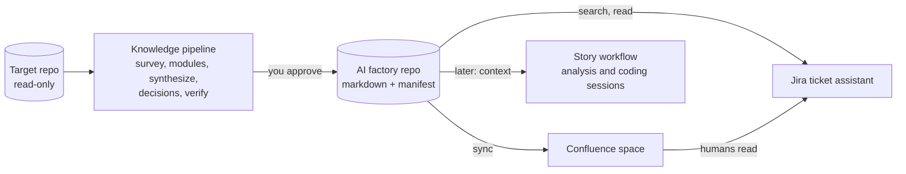
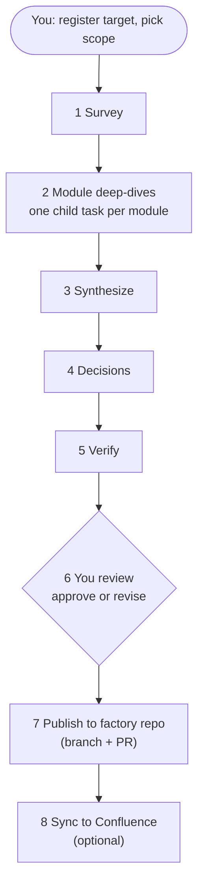
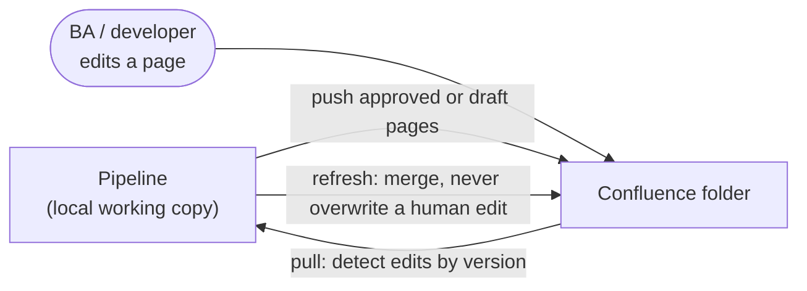

# Repo knowledge pipeline (proposal)

Status: **idea, not built.** Logged 2026-11-18. **Section 16 lists the decisions taken so far and wins over earlier text. Read sections 14 and 15 first: 14 changes the storage and the Confluence model from the first draft (sections 3, 4, 7 and 12 are partly superseded); 15 expands how stories use the knowledge (section 9).** Nothing here exists in the code yet; every tool, config key and stage name below is a proposal.

A second workflow next to the story workflow. Instead of turning a ticket into code, it turns a **target repo into reviewed knowledge documents** (architecture, modules, decisions, conventions). The documents are kept in a separate **AI factory repo**, can be **synced to Confluence**, and are then used in two places: by the BA and developers when a Jira ticket is written, and later by the story workflow's analysis and coding sessions.

Related: [architecture.md](architecture.md) (decisions this proposal changes), [workflow.md](workflow.md), [learnings.md](learnings.md), [../BACKLOG.md](../BACKLOG.md).

## 1. Why

- **Analysis sessions spend their time locating code.** On a very large repo (the target is about 20 GB) every requirement, design and plan session re-discovers the same structure. Check `duration_ms` in a few `dispatches/<id>/meta.json` files to get the baseline before building anything.
- **BAs write tickets without knowing the technical shape.** A ticket that ignores an existing module, a past decision or a contract with another team costs a round trip. Knowledge the BA can query at ticket time removes that.
- **Decisions are lost.** The code shows what exists, rarely why. ADRs, PR text and Jira history hold the why, scattered.

## 2. What this changes in existing decisions

[architecture.md](architecture.md) currently says "No code index or codemap" and "Codebase facts are suggested to you, not stored", to be revisited "when analysis sessions spend most of their time locating code". This proposal is that revisit. The two reasons behind the old decision are kept as hard requirements:

| Old objection | How this design answers it |
|---|---|
| An index goes stale | Every document carries the commit SHA and the files it cites. A `git diff` over the cited paths marks it stale, and a refresh re-runs only the affected modules (section 6) |
| Injected text can be planted by a hostile file or ticket | Nothing is used until a human approves it. Every claim cites `path:line` and is checked by code. Prompts keep the untrusted-content label and secret scan (section 9) |

The knowledge lives in the **AI factory repo**, not in `workflow.db`, and not in the target repo. When this ships, update the two decision rows in architecture.md and the "does not do" list.

## 3. Overview



The factory repo is the **source of truth**. Confluence is a published copy for people. The target repo is never written to by this pipeline.

## 4. The AI factory repo

A normal git repo that holds generated knowledge, reviewed through pull requests like any other change. Assumption to confirm: this is a **dedicated repo**, separate from this orchestrator's source. Its path is set in `config.json` as `knowledge_repo` (proposed), with a per-target `knowledge_slug`.

```
ai-factory/
  README.md                      what this repo is; do not hand-edit generated files
  <slug>/                        one folder per target repo
    index.md                     one page: purpose, module map, links. The only file always injected
    architecture.md              components, boundaries, data flow, diagrams
    conventions.md               naming, layering, error handling, test style, how to build and run
    glossary.md                  domain terms as the code and the business use them
    integration.md               other systems, APIs, queues, contracts, owners
    modules/<module>.md          one per module found by the survey
    decisions/<NNNN>-<title>.md  one per decision, labelled stated or inferred
    .meta/
      manifest.json              per document: commit SHA, cited files with hashes, status, Confluence page id
      claims.json                every claim with its citation and verify result
```

Rules for the files:

- Generated files start with a header: source repo, commit SHA, generated date, skill version, platform, `status: draft | approved | stale`.
- Every factual statement carries a citation: `[path:line]` into the target repo at the stamped SHA. A claim without one is dropped by the verifier.
- Decisions use a fixed template: context, decision, alternatives, consequences, **source**, and `basis: stated | inferred`. Inferred decisions are written as questions for a human, not as facts.
- Open questions use the same `- **Q1.**` format the story workflow already parses.

## 5. The pipeline

It reuses the machinery that exists: tasks, stages, read-only dispatches, versioned documents, approval gates, child tasks, FTS5. The new parts are a policy path, five skills, a verifier and a publisher.



| Stage | Session | Input | Output | Check by code |
|---|---|---|---|---|
| 1 Survey | read-only | the target repo, its instruction files | module list, languages, build and test commands, entry points | read-only guard |
| 2 Module deep-dive | read-only, one per module, fresh context | one module's folders, survey | `modules/<m>.md` | every citation exists |
| 3 Synthesize | read-only | the module documents (not the raw repo) | architecture, conventions, glossary, integration | cited paths exist |
| 4 Decisions | read-only | ADRs, PR text, commit messages, Jira (via MCP), and the orchestrator's own past story documents (section 16.4) | `decisions/*.md` | `basis` present, source present |
| 5 Verify | read-only, **different platform or model** | all documents plus the repo at the stamped SHA | claim-by-claim verdicts | deterministic pass first, then the AI pass |
| 6 Review | none | the verified set | your confirm or revise per document | approval recorded |
| 7 Publish | none (server writes files) | approved documents | commit and branch in the factory repo, PR opened for you | refuses unapproved documents |
| 8 Sync | none | factory repo documents | Confluence pages | section 7 |

### Scope and cost on a huge repo

- A run takes **named modules**, not the whole tree. The survey proposes modules; you choose which to deep-dive first.
- The module stage reuses the task-breakdown pattern: the parent is the overview, each module is a child with its own budget. The per-task `budget` already applies.
- Start with the least-understood module the team asks questions about, not the biggest.

### The verify stage

The reason documents can be trusted:

1. **Deterministic:** every cited file exists at the SHA, the cited line range is in bounds, every claim has a citation, no secret-looking string (existing scan), no claim left uncited. Failures are removed or sent back.
2. **AI pass on another model:** for each remaining claim, read the cited code and answer supported / not supported / contradicted. A "contradicted" claim blocks approval.
3. **Decisions:** `inferred` ones are listed as open questions for the human reviewer, who can promote them to `stated` with a source or delete them.

### New tools and skills (proposed)

- Skills in `orchestrator-agent/skills/`: `repo-survey`, `module-analysis`, `knowledge-synthesis`, `decision-mining`, `claim-verification`. Each gets an eval case with a fixture repo.
- `workflow-state`: a `knowledge` workflow kind in `policy.json` with its own stages and gates, so the stage rules stay in code.
- `dispatch`: a `knowledge` dispatch kind that is always read-only and gets the same restrictions, redaction and output scan as other dispatches.
- A `publish_knowledge` tool that writes only into `knowledge_repo`, only from approved documents, on a branch, never pushing and never touching the target repo.

## 6. Keeping it fresh

- `manifest.json` stores, per document, the SHA and a hash of each cited file.
- `knowledge status <slug>` compares those with the target repo's current state and lists documents as fresh, stale (cited files changed) or missing (new module).
- `knowledge refresh <slug> [--module m]` re-runs only the affected stages for stale documents and produces a new draft for review. Nothing is replaced without approval.
- At story intake, the orchestrator can check the modules a story touches and offer a refresh as a numbered option, never run it unasked (same rule as `edge-case-review`).
- A session that finds a claim contradicted by the code reports it under Open Questions, the same channel as "Suggested repo-instruction additions". The orchestrator logs it against the document and marks it stale.

## 7. Confluence sync

The factory repo is authoritative. Sync is **one-way, repo to Confluence**.

Design:

- **Mapping:** `manifest.json` records the Confluence page id and the last synced version per document. A space and parent page are configured per slug.
- **What syncs:** only documents with `status: approved`. Stale documents are synced with a visible "stale" banner or held back (open question 3).
- **Page content:** markdown converted to Confluence's format, with a top banner: "Generated from `<repo>@<sha>` on `<date>`. Edit in the AI factory repo, not here", plus a label such as `ai-generated`. Add the source repo and SHA as page properties so they can be searched.
- **Change detection:** hash of the rendered content; only changed pages are updated.
- **Edits made in Confluence:** before updating, compare the page's version with the last synced one. If someone edited it, **do not overwrite**: report it and let the owner choose between pulling the edit into the factory repo (as a draft) or overwriting.
- **Diagrams:** mermaid is not rendered by Confluence on its own. Options are to render to images at sync time, or to use a Confluence macro if one is installed. Decide after a one-page trial (open question 4).
- **How it talks to Confluence:** through the Atlassian MCP server the project already optionally uses for Jira, or its REST API. The Atlassian connection needs to be authorised first, and the available write tools must be checked before the design is fixed. **Not verified**: page-size limits, attachment handling for images, and rate limits.
- **Access:** the account used needs write access to the one space. Use a dedicated service account, not a personal one.

## 8. Jira ticket assistant for BAs and developers

Goal: when a BA creates or refines a ticket, they can ask the AI to check the idea or the technical approach against the knowledge, and get a short, cited answer that helps both the BA and the developer who picks it up.

### What it answers

A skill `ticket-assist` (proposed) takes the ticket and returns a structured comment:

| Section | Content |
|---|---|
| Where this lands | the modules and integration points the request most likely touches, with links to the knowledge pages |
| Fit with the current design | does the idea match the architecture, or work against it; the relevant decisions and why they were made |
| Risks | breaking changes, contracts with other systems, data or migration impact, known constraints |
| Questions for the BA | gaps and ambiguities, in the same numbered open-question form |
| Hints for the developer | conventions to follow, similar past work, suggested split if it is big |
| Confidence and freshness | `knowledge last verified at <sha> (<date>)`, plus any touched module that is **stale** |

It can also take a short "technical solution" the BA or developer pasted and review it against the decisions and conventions.

### How it is triggered (build in this order)

1. **Chat first.** In the orchestrator chat: `review PROJ-123`. It reads the ticket through the Jira MCP, searches the factory repo (FTS over the knowledge documents plus the module map), and answers in chat. Nothing is written to Jira. This proves usefulness with no new infrastructure.
2. **Comment on demand.** Add "post this as a comment on the ticket" as an explicit numbered option the person chooses.
3. **Jira-side trigger** (later). A Jira automation rule fires on a label or a comment keyword (for example `@ai-review`) and calls a small endpoint that runs the skill headless and posts the comment. This needs a hosted service and is the point where the MCP stdio design stops being enough; see the "MCP spec" item in BACKLOG.md. Treat it as a separate project with its own security review.

### Retrieval

The assistant answers from the **knowledge documents, not from the raw repo**, so it is fast and cheap and cannot leak code that was never approved. Steps: extract terms and likely module names from the ticket; look them up in `index.md` and the FTS index; read the top module, decision and integration documents; answer with citations to document paths (and Confluence URLs once synced). If the knowledge is thin or stale for the area, it says so instead of guessing. An optional second option, "check the code", dispatches a read-only analysis session for a specific question.

### Guardrails

- **Advice only.** It never edits ticket fields, status or description, and never creates sub-tasks. Output is a comment, labelled AI-generated.
- **The ticket is untrusted input.** The existing untrusted-content warning applies; the skill reports suspected injection instead of obeying it.
- **Audience.** A Jira comment is visible to everyone on the ticket. The answer may only use content from documents approved for that audience. Decide whether the knowledge needs a per-document visibility flag (open question 5).
- **No secrets or internals** beyond what the approved documents contain; the secret scan runs on the output before it is posted.
- **Honest limits.** It must say when it does not know. A confident wrong answer to a BA is worse than "no knowledge about this area yet".

## 9. Using the knowledge in the story workflow (later phase)

- Dispatch prompts get `index.md` always, plus the module and decision documents for the task's modules, chosen from `files_affected` (analysis) or the plan's "Files touched" (coding), under a token cap.
- Analysis sessions get it as context only and are told to trust the code over the document when they disagree and to report the mismatch.
- Only `approved` documents are injected. The injected block is labelled as data, redacted, and listed in the dispatch record so it is auditable.
- Measure the benefit before keeping it: the same story with and without knowledge, comparing `duration_ms`, tokens and plan quality.

## 10. Risks

| Risk | Mitigation |
|---|---|
| Invented rationale for decisions | `stated` / `inferred` labels, source required, inferred ones become questions for a human |
| Stale knowledge misleads | SHA and cited-file hashes, `knowledge status`, freshness line in every BA answer, refresh only on approval |
| Planted instructions reach every prompt | Human approval, citation check, secret scan, untrusted-content label, only approved documents injected |
| Cost on a 20 GB repo | Named modules only, fresh small sessions per module, per-task budget, synthesize from module documents instead of the raw repo |
| Confluence and repo diverge | One-way sync, version check before every update, never overwrite a human edit silently |
| Wrong or overconfident BA advice | Cited answers only, freshness shown, "I don't know" allowed, advice only, evals on a seeded fixture |
| Sensitive details exposed in Jira comments | Approved-for-audience content only, output secret scan, decide on a visibility flag |
| Generated docs drown the team | PR review in the factory repo, small first slice, delete what nobody reads |

## 11. Evals

- A **fixture target repo** with known facts (modules, one real decision, one trap such as a deprecated module). Checks:
  - recall: the known facts appear;
  - precision: no uncited claim, no false claim;
  - decisions: the trap decision is labelled `inferred` unless the fixture contains its source.
- A **verifier eval** with seeded false claims; the verify stage must reject them.
- A **ticket-assist eval** with sample tickets: right modules named, a conflicting idea flagged, "no knowledge" returned for an unrelated area.
- All run through the existing `evals check` (free, shape checks) and `evals run` (live) commands, with `--repeat 3` for flakiness.

## 12. Build order

Each phase ends with something you can use and measure. Stop at any phase if it does not pay off.

| Phase | Build | Done when |
|---|---|---|
| 0 Baseline | Record analysis `duration_ms` and tokens for 3 to 5 recent stories on the big repo | You have numbers to compare against |
| 1 Pipeline to the factory repo | `knowledge_repo` config, survey, module-analysis, synthesis, publish (branch + PR) for **one module** | A module document in the factory repo that a developer says is correct |
| 2 Verify and freshness | Deterministic verifier, AI verifier on another model, manifest, `knowledge status` and `refresh` | A seeded false claim is rejected; a changed file marks its document stale |
| 3 Decisions | decision-mining skill and the `stated` / `inferred` flow | A real past decision is captured with its source |
| 4 Confluence sync | One-way sync of approved documents, banner, labels, version check | A page appears, updates on change, and a manual edit is detected and reported |
| 5 Ticket assistant, chat | `ticket-assist` skill, `review PROJ-123` in chat, nothing written | A BA says the answer helped on 3 real tickets |
| 6 Comment on demand | Post to Jira as an explicit option | Comments are labelled, cited and pass the output scan |
| 7 Story workflow context | Inject approved knowledge into dispatches | The with/without comparison shows a gain in time or quality |
| 8 Jira-side trigger | Automation rule plus hosted endpoint | Separate design and security review first |

## 13. Open questions

1. **Is the AI factory repo this orchestrator repo or a separate one?** The design assumes separate, so generated files do not mix with source.
2. **One factory repo for all targets, or one per target?** One shared repo is simpler; per-target repos give separate access control.
3. **Sync stale documents or hold them back?** A banner is honest and keeps the page; holding back is safer.
4. **How do diagrams reach Confluence?** Render to images at sync, or a macro. Needs a one-page trial.
5. **Does the knowledge need a visibility flag** (for example internal-only), so the Jira assistant never repeats it to a wider audience?
6. **Who reviews and approves documents:** one owner per module, or the story's usual approver?
7. **Jira trigger hosting.** Where would the endpoint for phase 8 run, and who maintains it?
8. **Which model verifies?** It should differ from the one that wrote the documents. The existing `review_platform` setting is a candidate.
9. **Confluence tooling.** Which Atlassian MCP write tools exist and what are their limits? Not checked yet; the Atlassian server also needs authorising.
10. **Research behind this** (blogs and preprints, indicative only): spec-first and verify-at-every-handoff practice, and the finding that models miss most issues a human reviewer flags when reading a diff alone, which is why the verify stage reads cited code rather than trusting the writer.

## 14. Revision after first review (supersedes sections 3, 4, 7 and 12 where they differ)

Decisions taken in review. They are kept as a separate section while still open; fold them into the main text once settled.

### 14.1 Who drives the pipeline

**One orchestrator, no new agent for the pipeline itself.** The knowledge pipeline is a second workflow kind on the same `workflow-state` and `dispatch` servers, started from the same chat (`build knowledge for <repo>`, `refresh knowledge <repo>`, `what's stale?`).

One refinement: the pipeline is a **fixed sequence with a fan-out** (survey, then N module sessions, then synthesize, decisions, verify). It needs no judgement between steps. Driving 20 module sessions through chat would fill the orchestrator's context, which is the problem this project exists to avoid. So the server runs the sequence itself (a `knowledge run` runner, also callable from the CLI) and the orchestrator only starts it, reports progress, relays open questions and asks for approval. The orchestrator stays small; the runner is plain code.

A **separate agent is right for one thing only: the BA ticket assistant** (section 8). Different audience, a smaller tool list (read Jira, read knowledge, comment; no dispatch, no coding), and no access to the story workflow. Same servers underneath.

### 14.2 Where it is stored

The working copy lives in the orchestrator's data dir, replacing the separate factory repo for now:

```
~/.ai-sdlc-orchestrator/knowledge/<slug>/
  index.md  architecture.md  conventions.md  glossary.md  integration.md
  modules/<module>.md   decisions/<NNNN>-<title>.md
  .meta/manifest.json   .meta/claims.json
```

Same layout and rules as section 4. Add `knowledge/` to the daily backup. The factory repo is not lost: pointing `knowledge_dir` at a git folder (the way `shared_dir` works today) gives history, PR review and team sharing later, with no redesign. This answers open questions 1 and 2: no separate repo needed to start.

### 14.3 Confluence is where humans review and edit (two-way, with rules)

The first draft said one-way sync. The intended use is different: **the AI maintains the pages in a Confluence folder; BAs and developers review and correct them there; the pipeline learns from their edits.** So sync is two-way, with clear ownership.



- **Layout.** One parent page per repo slug, one child page per document. Page properties hold source repo, SHA, generated date, status and the local document id. Label `ai-generated`.
- **Each page has two parts.** The *generated body* is owned by the AI. The *Reviewer notes and corrections* section at the bottom is owned by humans and is **never overwritten**.
- **Edits to the generated body are allowed.** On every sync the pipeline compares the page's Confluence version with the last one it wrote. If it changed, it pulls the page, diffs it against its own last text, and records each difference as a **human correction**.
- **Human corrections win.** A refresh starts from the corrected text, keeps human-edited sentences as they are, marks them `human-verified` (not re-checked against code, but flagged if the code now contradicts them) and only regenerates what the code changes affect. The result is shown to the reviewer as a diff before it is pushed.
- **No silent overwrite, ever.** If the page and the pipeline both changed, the pipeline stops and reports the conflict.
- **Tell humans how to edit.** A banner at the top of each page: "Maintained by the AI pipeline. Fix errors by editing this page or adding a note below; the pipeline reads your edits at the next refresh."
- **Injection risk.** Anyone who can edit a page can now put text into prompts. Restrict edit rights on the folder to the team, inject only approved versions, keep the untrusted-content label, and run the secret scan on pulled text.
- **Unverified:** the Atlassian write tools, how version and diff data come back, page-size limits and image handling must be checked before this is fixed.

### 14.4 Approval

Approval is the same idea the project already uses for plans: a person says "this is reviewed", the server records it **against a specific version**, and any later change voids it. What differs is *who* and *where*. Options, simplest first:

| Option | How | Good for |
|---|---|---|
| **A. In chat (phase 1)** | You read the local document (or the Confluence page) and say `approve module orders`. Recorded like a plan approval | Getting started, one reviewer |
| **B. Confluence label** | A listed reviewer adds the label `kb-approved` to the page. The pipeline reads it, records the page version and who added it, and voids it if the page changes afterwards | BA and developers approving where they already work |
| **C. Confluence's own approval feature** | If the plan or space has page approvals, use that | Only if it exists and the API exposes it. **Not verified** |

**Recommendation:** start with A, add B in the Confluence phase. Rules for both:

- Config lists who may approve, per module or globally (proposed `knowledge.reviewers`). An approval from anyone else is ignored.
- Approval is per document and per version. An edit after approval makes the page `draft` again.
- **What approval gates:** a document that is not approved is still visible on Confluence with a "Draft, not reviewed" banner, but it is **not used** by the BA assistant as fact (it can mention it as unreviewed) and **not injected** into dispatches.
- What a reviewer actually checks is short: the verify stage already confirmed the citations, so the reviewer reads the module summary, the `inferred` decisions (each shown as a question: keep, correct with a source, or delete) and the open questions. Aim for minutes per module, not an audit.

### 14.5 What changes in the build order

| Phase (section 12) | Change |
|---|---|
| 1 | Writes to `~/.ai-sdlc-orchestrator/knowledge/<slug>/`, started from the chat with a runner. No factory repo. Approval by option A |
| 4 | Becomes **two-way Confluence sync**: push pages, detect human edits by version, record corrections, refresh from corrected text, conflict report. Add approval option B here |
| 5 | The BA assistant reads approved knowledge. Retrieval uses the local copy for search speed and cites the Confluence page URL |
| later | `knowledge_dir` pointed at a git folder if the team wants history and PR review |

### 14.6 Open questions after this review

Answered: 1 (no separate repo to start), 2 (one working store), and the sync direction in 3.

Still open: who the reviewers are per module; whether option C exists; how corrections are stored so a refresh cannot lose them (proposal: kept in `.meta/corrections.json` with the page version they came from); diagram handling in Confluence (question 4); the audience visibility flag (question 5); the Jira-trigger host (question 7).

## 15. Using the knowledge in the story workflow (expands section 9)

The story workflow reads the approved knowledge at every stage: architecture, module and technical documents, ADRs, conventions, glossary, integration notes. The goal is that analysis and coding sessions stop re-discovering the repo, and that past decisions bind new work instead of being rediscovered or contradicted.

### 15.1 Who reads it

- **The dispatch server selects and injects**, the same way it injects learnings and repo instruction files today. The orchestrator never pastes documents through the chat, so its context stays small.
- **The orchestrator reads only the one-page index** at intake (a proposed `read_knowledge_index(project_root)` tool, like `read_learnings`). It uses the module map to name the likely modules and to score `files_affected` and `has_precedent` from real data instead of guessing from ticket text (this also covers backlog item 3). It tells you which knowledge a dispatch used and how fresh it was, and offers a refresh when it is stale.
- **Source of the text:** the local approved copy in `~/.ai-sdlc-orchestrator/knowledge/<slug>/`, not live Confluence. Dispatches stay fast and repeatable, and a human edit reaches them only after the pull and approval steps in section 14.3.

### 15.2 What each stage gets

| Stage | Knowledge given | Used for |
|---|---|---|
| Triage | index only (module map, decision list) | Which modules, how many files, whether a precedent exists |
| Requirement | glossary, summaries of the touched modules, integration notes, ADRs that constrain them | Asking the right questions, using the team's terms, not promising what an ADR forbids |
| Design | architecture excerpt, touched module documents, **all ADRs for those modules**, conventions, integration notes | Choosing an approach that fits; each applicable ADR is followed or explicitly challenged |
| Plan | module documents, conventions (layering, naming, error handling), test style, build and test commands | A plan that names the right files, follows local patterns, and has a realistic Test Plan |
| Task breakdown | module boundaries and owners, integration notes | Splitting along real module and repo seams |
| Test authoring | test conventions, how tests are run | Tests in the right place and style |
| Implementation | conventions, the module documents for the plan's "Files touched", ADRs that constrain them (short form) | Following local patterns without re-reading the whole repo |
| Review | applicable ADRs and conventions as a checklist | "Does this diff violate decision 0007?" in addition to the requirement and plan checks |
| Related repos (read-only) | the other repo's `index.md` and integration notes | Understanding a neighbour cheaply instead of letting a session explore it |

### 15.3 How the server chooses what to inject

A deterministic selector, not a model's judgement:

1. **Modules:** from the task's recorded modules, the plan's "Files touched" (mapped to modules by path), or ticket keywords against the module map when neither exists yet.
2. **Decisions:** each ADR lists the modules it applies to in the manifest, so "ADRs for these modules" is a lookup. FTS5 over the knowledge is the fallback for a ticket that matches no module.
3. **Priority under a token cap** (`knowledge.max_tokens` per stage, proposed): index, then applicable ADRs, then touched module documents, then conventions, then an architecture excerpt, then glossary. Cut at section boundaries, never mid-sentence.
4. **Status filter:** only `approved` documents. An approved document whose cited files changed is `stale`: it is still included, with a header "STALE: the files it cites changed since `<sha>`; check against the code", because stale-but-flagged usually beats nothing. A document that was never approved is not injected.
5. **Record it:** the dispatch's `meta.json` lists `knowledge_used` (document ids, versions, SHAs, stale flags) and what was cut by the cap, so a wrong answer can be traced to the document that caused it.

### 15.4 Rules in the prompt

- The knowledge block is labelled data, redacted and scanned like everything else; the untrusted-content warning still applies.
- **Precedence: the code wins.** If a document disagrees with the code the session reads, trust the code and report it.
- **An accepted ADR is a constraint.** Design and plan must follow it, or raise an **ADR conflict** open question stating which decision is in the way and why. They may not silently work around it. This reuses the existing open-question and wrong-spec return flow.

### 15.5 What the server checks (enforced, not requested)

- **ADR coverage:** the server computes the list of ADRs that apply to the touched modules. The design and plan documents must contain a "Decisions considered" section naming each one as `follows`, `not applicable` (with a reason) or `conflicts` (with a question). A missing ADR id fails the shape check, like a missing template heading today.
- **Knowledge used is recorded** on every dispatch, so the independent review can be told which decisions applied.
- **Review:** the review session receives the applicable ADRs and conventions and must report, per ADR, `respected` or `violated` with evidence.
- Eval cases (section 11) gain the same checks: a fixture ADR the design must cite, and a trap where the ticket asks for something the ADR forbids and the document must raise a conflict.

### 15.6 The loop back: stories feed the knowledge

Using knowledge only helps while it stays true, so each story feeds back, through humans:

- **Mismatch reports.** A session that finds a document contradicted by the code lists it under a "Knowledge feedback" heading. The server logs it against the document and marks it stale.
- **Touched modules go stale.** When a story's branch changes files a module document cites, that document is marked stale at completion, and a refresh is offered. Staleness is then detected within one story, not at the next full run.
- **ADRs from stories.** A heavy story's design document records a real decision. After the work is merged, the pipeline proposes it as a **draft ADR** (basis `stated`, source: the task's design document and PR) for the reviewers to approve through the normal approval step. Nothing is added to the approved set without a person.
- **Wrong-spec returns** that exposed a missing constraint propose a convention or ADR in the same way.

### 15.7 Cost and measurement

Expect sessions to read less of the repo and ask fewer wrong questions, at the price of a larger prompt. Per-stage caps keep that bounded. Measure with the baseline from phase 0 of section 12: the same stories with and without knowledge, comparing `duration_ms`, tokens, number of open questions, plan rejections, test retries and review findings. Keep the feature only if those improve. `knowledge.enabled` (global and per repo) turns it off.

### 15.8 Risks specific to this use

| Risk | Mitigation |
|---|---|
| A wrong ADR or document is applied confidently | Only approved documents, code wins on conflict, `knowledge_used` recorded for tracing, per-ADR verdicts in review |
| An outdated ADR blocks a good change | An ADR conflict is a question to a human, not a block; reviewers can supersede an ADR through the same approval flow |
| Large prompts raise cost | Selector plus token caps by priority; measure against the baseline |
| Sessions stop exploring and miss new code | "Code wins" rule, stale flag, mismatch reporting |
| A hostile edit in Confluence reaches prompts | Restricted edit rights, approval before injection, untrusted-content label, secret scan on pulled text |
| Wrong module mapping for a task | Module chosen from real paths where possible; the orchestrator shows the chosen modules and the user can correct them |

### 15.9 Build order for this part (replaces phase 7 in section 12)

| Step | Build | Done when |
|---|---|---|
| 7a | Selector and injection into analysis stages, `knowledge_used` in `meta.json`, `read_knowledge_index` for triage | A requirement and a design dispatch show the right documents in `meta.json` |
| 7b | Applicable-ADR list, "Decisions considered" check on design and plan, ADR conflict as an open question | A fixture story that conflicts with an ADR raises the conflict |
| 7c | Knowledge in implementation and test-authoring prompts, ADRs and conventions in the review prompt | A seeded ADR violation is found by the review |
| 7d | Mismatch reports, staleness at story completion, draft ADR from a merged story | A merged story yields a draft ADR that a reviewer can approve |
| 7e | With and without comparison on real stories | Measured gain, or switch it off |

### 15.10 Open questions

1. Is a stale approved document better injected with a warning (proposed) or left out?
2. What token caps per stage are realistic? Pick them from the first real documents.
3. Should the ADR-coverage check fail the document or only warn at first? Proposed: warn for the first month, then fail, as with `scope_check`.
4. Who approves a draft ADR produced from a story: the story's approver or the module reviewers?
5. How are module-to-path mappings kept right when folders are renamed? Proposed: the manifest stores paths, and a rename marks the module stale.

(All of these are answered in section 16.)

## 16. Decisions (2026-11-18)

These resolve the open questions in sections 13, 14.6 and 15.10. Where they differ from earlier text, this section wins.

### 16.1 Decided by you

| Question | Decision | Effect on the design |
|---|---|---|
| Who sees Jira tickets and comments | **Only developers and BAs**, no external parties | The audience flag is dropped for now. Every approved document may be used by the ticket assistant and quoted in Jira comments. Revisit if an external party is ever added to a Jira project |
| Who reviews and approves | **Everyone (developers and BAs) can review, edit and approve** | No reviewer list to maintain. Approval right = edit right on the Confluence folder, so keep that folder's edit permission limited to the team (it is also the injection control in 14.3). Every approval records who gave it and the page version |

Two small rules keep "everyone can approve" safe:

- **One approval is enough**, per document and per version, and any later edit voids it (14.4).
- **The author cannot be the only approver.** For a draft ADR from a story, the person who approved that story's plan cannot approve the ADR. For pipeline-generated documents there is no human author, so any one person may approve.

### 16.2 Decided on your behalf (accepted by agreeing to the recommendations)

| Question | Decision |
|---|---|
| Stale approved document | Inject with a `STALE` header and a "check against the code" rule. If more than about half its cited files changed, treat it as missing and offer a refresh |
| ADR coverage check | Warn first; switch to fail after about 10 real stories with no false alarms |
| Draft ADR approver | Any developer or BA other than the story's plan approver (see 16.1) |
| Token caps per stage | Start with guesses, tune from `knowledge_used`: triage 2k, requirement 4k, design 8k, plan 6k, implementation 4k, review 5k |
| Folder renames | The manifest stores paths; a rename seen by git marks the module stale and a refresh remaps it |
| Confluence's own approval feature | Not depended on. Use the label approval (14.4 option B) |
| Human corrections | Stored in `.meta/corrections.json`, keyed by claim and page version |
| Diagrams in Confluence | Text-only at first (tables and lists); rendered images after a one-page trial |
| Verifying model | The `review_platform` setting, always different from the writer |
| Jira-side trigger | Deferred (phase 8), with its own security review |
| Factory repo | Not needed to start; `knowledge_dir` can point at a git folder later |

### 16.4 Past story documents as a decision source

`~/.ai-sdlc-orchestrator/artifacts/<task_id>/` already holds the requirement, design, plan and test documents of earlier stories (17 files across 7 tasks on 2026-11-18). They record real decisions, the alternatives that were rejected, and the assumptions behind them, so the decision-mining stage reads them as one input next to ADRs, PR text, commits and Jira.

- **Use the latest version of each document** (`design.v2.md` over `design.v1.md`), and read the earlier one only to see what changed.
- **Where the decisions come from:** the design document's chosen approach and rejected alternatives. The plan's "Files touched" maps each decision to modules by path, which fills the ADR's module list used in 15.3.
- **Basis and source:** a decision taken from a design you confirmed is `stated`, with the task id and document version as its source. The text was written by a model but a person approved it, which is stronger than inference. A decision found only in a requirement's assumptions, or in a version that was later revised away, is `inferred` and becomes a question.
- **Findings from reading the real data (2026-11-18):**
  - Only 7 of 21 tasks have stage documents. Light-path tasks skipped straight to implementation, so they have none. For those, the task description, `target_files_json` and the PR number are the only sources.
  - `approvals` records plan, requirement and review approvals but **no design approval**. A design counts as confirmed (`stated`) only when its task went on to a plan approval or to done; otherwise treat its decisions as `inferred`.
  - The same repo is registered under two paths (`D:/projects/vscode-dev-utilities` and `D:/projects/khainx/vscode-dev-utilities`), and the data covers at least three repos (DevMate Kit, MedHealth PracticeManager, justice). Knowledge must be keyed by repo identity (for example the git remote URL), not by path, or one repo gets two knowledge sets.
  - The "Suggested repo-instruction additions" sections in design documents are ready-made input for `conventions.md`.
  - Documents mention in-flight work by task id (for example "do not absorb task_ff093bbf"). That is not durable knowledge; the decision step must drop it.
- **Skip what is not a decision:** stories that never reached design (for example a task with only a plan or a requirement) give context, not ADRs.
- **They are a good first test.** Phase 1 can run on these documents before touching the big repo, since they are small and local. Check that the pipeline produces a sensible draft ADR from `task_6a108c6d` and `task_c204f5d5`, whose design was revised.
- **Same safeguards as any source:** redaction, the untrusted-content label, and human approval before an ADR is used. The documents are not edited or moved; the pipeline only reads them.
- **Going forward:** section 15.6 already proposes draft ADRs from merged stories. This is the same mechanism applied to stories finished before the pipeline existed, a one-off backfill.

### 16.3 Still open

- Whether Confluence page approvals exist and are readable through the API (not needed to start).
- The real Atlassian write tools, page limits and image handling (check once the Atlassian server is authorised).
- The real token caps (after the first real documents).

## 17. Built so far (2026-11-18)

Stage 0 and the first three skills exist. Nothing is wired into the workflow yet.

| Piece | Where | State |
|---|---|---|
| Scanner (stage 0, no AI) | [src/knowledge/scan.ts](../src/knowledge/scan.ts), command `knowledge scan --repo <path>` | Built and tested (7 tests). Run on PracticeManager in 1.4 seconds; the repo stayed untouched |
| `repo-survey` skill | [orchestrator-agent/skills/repo-survey/](../orchestrator-agent/skills/repo-survey/SKILL.md) | Written, with an eval case and golden. Not yet run live |
| `module-analysis` skill | [orchestrator-agent/skills/module-analysis/](../orchestrator-agent/skills/module-analysis/SKILL.md) | Same |
| `decision-mining` skill | [orchestrator-agent/skills/decision-mining/](../orchestrator-agent/skills/decision-mining/SKILL.md) | Same |
| Eval check `min_citations` | [src/evals/checks.ts](../src/evals/checks.ts) | A knowledge page must carry `path:line` citations |
| Remote-based slug | `knowledgeSlug` in scan.ts | The same repo at two paths gets one slug; credentials in a remote URL are removed before anything is written |

What the scanner records: projects with target frameworks, project and package references (including `packages.config`), test projects, solutions, file counts per project, most-changed units, ticket-id prefixes in commit subjects, existing instruction files, docs, ADRs and CODEOWNERS, and configuration **key names only**. It never opens files that match the restriction deny list or look like secrets, skips vendored folders (a `packages/` folder is kept when it holds JavaScript workspaces), and writes to `~/.ai-sdlc-orchestrator/knowledge/<slug>/.meta/scan.json`, never into the repo.

What the first real scan of PracticeManager showed (76 projects, 19,154 files considered, 93 secret-like files not opened):

- Two Jira projects appear in commit subjects: `PM` (419) and `MEB` (415). The decision and ticket stages need both.
- Frameworks: net472 x22, netcoreapp3.1 x22, net8.0 x15, netstandard2.0 x11, netcoreapp2.2 x2, net461 x1.
- Sixty instruction files, five docs, zero ADRs, no CODEOWNERS.
- The scan reads at most 40 configuration files; many are per-environment transforms. If the key list matters, raise the cap or prefer base files.

### First live results (2026-11-18)

Evals: `repo-survey`, `module-analysis` and `decision-mining` pass their cases on Copilot (`gpt-6-luna`). Two failures were fixed on the way: a model that dropped the closing `>>>` of the output wrapper (the extractor now tolerates it), and `decision-mining` marking a commit-message decision `stated` (the skill now says a commit message, ticket title or code structure is `inferred`).

Real run of `repo-survey` on PracticeManager, read-only, repo left unchanged:

| | Run 1 | Run 2 (skill improved, no feedback) |
|---|---|---|
| Time, estimated tokens in/out | 116 s, 15.6k / 4.1k | 204 s, 16.0k / 3.6k |
| Modules | 15 | 11 |
| Projects placed | 76 of 76 | 76 of 76 |
| Dependencies missing versus project references | 3 real ones | 0 |
| Dependencies invented | 0 | 0 |
| Folders with no project mentioned (`DbScripts` 3,388 files, `MedHealth.Database`, ...) | none of 10 | all, as a database and delivery module |
| Modern .NET to .NET Framework references surfaced | no | yes |

Run 2 passes `knowledge check-survey`. Two cautions: the skill now tells the model that code checks the dependency line, so the pass is partly by design; and each run is one sample, so repeat it (`--repeat 3`) before trusting it. The checker is the part to rely on, not the model's promise. It found that run 1's "shared core depends on the web app" edge came only from a test project, so it ignores edges that come from test projects when deciding what is required.

The accepted draft is kept at `~/.ai-sdlc-orchestrator/knowledge/<slug>/survey.draft.md`.

### How to try it by hand today

1. `node dist/cli.js knowledge scan --repo D:/projects/medhealth/PracticeManager` prints a summary and writes scan.json.
2. In the orchestrator chat, ask for an analysis dispatch with the skill `repo-survey`, passing the printed summary in the instructions and `~/.ai-sdlc-orchestrator/knowledge/<slug>/` as an additional read root, so the session can read scan.json.
3. Read the result in the dispatch output. Storing it as a stage document does not work yet, because the workflow has no knowledge stages.

### Not built yet, in order

1. The runner and the `knowledge` workflow kind: stages in `policy.json`, storing documents under `knowledge/<slug>/`, fan-out over modules, progress reporting.
2. Injecting the scan and the survey into the later stages automatically, so step 2 above needs no manual paste.
3. `knowledge-synthesis` and `claim-verification` skills, the deterministic citation checker, the manifest and `knowledge status`.
4. Approval, Confluence sync, `ticket-assist`, and use in the story workflow (sections 14 and 15).
5. Run the three new eval cases live (`evals run --case survey-three-projects`, then the other two) before trusting the skills. This costs real AI sessions.

### First module page (2026-11-18)

`module-analysis` on "Azure functions and document conversion" (PracticeManager, survey module M9): 147 s, about 16k tokens in and 2.6k out on Copilot. The page cites 80 `path:line` references. A throwaway script confirmed that every cited file exists and every line number is within the file (0 bad). Spot checks of the .NET 8 target, the NU1701 comment, and the Service Bus trigger names matched the code. The PracticeManager repo stayed clean. The page correctly found the net8.0 to net472 risk and the repo's own skills for "how to change it safely". The draft is at `~/.ai-sdlc-orchestrator/knowledge/practicemanager-982d78/modules/azure-functions.draft.md`.

Limits: the check only proves the line exists, not that it says what the sentence claims. That needs the claim-verification stage (a different model) and a proper `check-module` in the repo, which is not built yet. The page lists "Open Questions: None", which is suspicious for a module this size, and it was not compared against a person's knowledge of the module.

### `knowledge check-module` (built 2026-11-18)

`node dist/cli.js knowledge check-module --repo <path> --module <page.md> [--sha <commit>]` checks a module page against the repo: every cited file exists inside the repo and every cited line is in range; every fact bullet cites something; a backticked name in a bullet appears in a file that bullet cites (or in its path); all template sections are present; the Source line names the expected commit. It exits 1 with repair-ready text. The Azure Functions page passes (80 citations). 7 tests; the full suite is 137 tests, all passing. It still cannot tell whether a sentence is true: that is the claim-verification stage, not built yet.

### Claim verification (built and tried 2026-11-18)

Code splits a module page into claims (each cited bullet) and attaches the cited lines (`knowledge claims --repo --module`), the `claim-verification` skill answers `supported | partial | unsupported` per claim, and `knowledge claims ... --verdicts <file>` counts the answers (exit 1 if any claim is not supported or has no verdict). Offline: 3 tests, eval case `claim-verification-basic` (the full suite is 139 tests, all passing).

Live on the Azure Functions page: 32 claims, 25 supported, 7 partial, 0 unsupported (123 s, about 30k tokens in, 0.4k out). The partial verdicts are over-reach more than invention: "tests cover services and middleware" when the cited lines show one processor test; "per-invocation tenant context" when the lines only register the middleware; `RedisConnection` named but not in the cited lines; "tenant-scoped" database context not shown. The next step is a repair pass that sends these back to the writer. Caveats: the verifier ran on the same platform as the writer (use `review_platform` for a different model in the real runner); one run only, so the result is not yet stable; "redacted: assigned-secret 5" in the dispatch log means the secret scan changed something in the output, which should be looked at. Verdicts are saved next to the page as `azure-functions.verdicts.md`.

### Repair pass (built and tried 2026-11-18)

`knowledge repair --repo --module [--verdicts]` prints a REPAIR block (the page plus the `check-module` findings and every partial or unsupported verdict) and nothing when all is well. The `module-analysis` skill has a repair mode: return the corrected page, narrowing, re-citing or removing flagged statements without adding claims. Live on the Azure Functions page: repair 100 s (19k in, 2.7k out), `check-module` passes (82 citations), re-verification 59 s: 31 of 32 supported (was 25 of 32). The one left is C25 (configuration key names): the verifier could not see a connection-string key. The dispatch log showed secret redaction ("assigned-secret") on the first verification, so the redactor probably hides lines such as `X = "..."` from the verifier. Check this before trusting verdicts on configuration claims. The saved page and verdicts in `modules/` are the repaired versions. One repair round took the page from 7 flagged claims to 1.

### Redaction hid configuration reads from the verifier (found and fixed 2026-11-18)

Confirmed by running the redactor over the claim pack: it rewrote `var clientSecret = configuration[$"tscp:...:ClientSecret"]` and `var seqApiKey = loggingConfiguration["Seq:ApiKey"]` (reading a key, not holding a secret) and the key name `ConnectionStrings:HangfireDb` in prose. The verifier then saw `[REDACTED]` where the key name should be, and flagged correct configuration claims. Fix: `assigned-secret` no longer matches a value that is an index lookup (`name[`...); one test added (suite 141, all passing); a literal such as `clientSecret = "..."` is still redacted. Not changed: a key path written as `ConnectionStrings:HangfireDb` is still redacted, because it has the same shape as `password: Hunter2xyz`; weakening that rule would risk real secrets. Page text that names configuration keys can therefore show `[REDACTED]` for such keys: pages should use the key name without a section prefix, or a verifier verdict on such a line should be read with this in mind.

### The runner: `knowledge run` (built and tried 2026-11-18)

`node dist/cli.js knowledge run --repo <path> [--modules M1,M2|all] [--max-repairs 2] [--max-sessions 40] [--verifier <platform>] [--reuse-survey]`

Flow: scan (code) -> survey -> `check-survey` -> repair (up to N rounds) -> stop and list the modules unless `--modules` is given -> per module: write, `check-module`, claim verification in batches of 12 (unanswered claims asked once more), repair (up to N rounds), keep the best round. Output: `survey.draft.md`, `modules/<id>-<name>.draft.md` with `.verdicts.md`, and `.meta/manifest.json` (commit, sessions, tokens, per-document status `clean | needs-review | failed`, the remaining problems, writer and verifier platform, whether the verifier was independent, skill versions). Nothing is written into the repo and nothing is marked approved: a person does that. `--max-sessions` is a hard stop. The AI sessions are injected (`src/knowledge/run.ts` takes a `Session`; `session.ts` is the real one over the dispatch path), so the control flow has tests with a fake session (3 tests; the suite is 144, all passing).

Live on PracticeManager module M9 (survey reused), two runs:
- Run 1 (before batching): the verifier answered only 8 of 23 claims in round 2, so the page was left with 15 unanswered claims. Round 1's repair also failed the code check.
- Run 2 (batched, 11 sessions, 152k tokens in, 6.7k out): 17/23 supported, then 22/23 after one repair, then 20/23 after the second (a repair made the page worse). The runner now keeps the best round, not the last. The verifier still skipped the last claims of a batch (C22, C23) even on the retry; the cause is not found yet (the raw verdicts file ends at C21). Status stayed `needs-review`.
- The repo stayed clean. The verifier ran on the same platform as the writer (no `review_platform` set), which the run prints as a note.

What this says: the loop is bounded, recoverable and honest about what is left, but model verdicts and repairs are noisy: the same page scored 17, 22 and 20 supported over three rounds, and every claim set is judged on its own. A page is "clean" only when everything is supported in one round, which may be too strict for noisy verdicts; a person reviewing the remaining list is the real gate.

### Skipped claims and the verdict rule (2026-11-18)

Cause of the skipped claims: not the claims themselves. The same two claims (C22, C23) were answered at once when sent alone, so the verifier sometimes stops early or returns nothing for a batch. The runner now asks again for unanswered claims up to twice (it worked: 6 left out in round 0, all answered on the re-ask) and gives every flagged claim a second look, keeping it flagged only if the second look agrees. Claim text no longer carries stray `;` left from removed citations. Live on M9, third run (10 sessions, 138k tokens in, 5.6k out): the first page failed the code check (a name not in its cited files), the repair gave 20/21 supported and stayed there; the runner kept the best round. The one claim still flagged is the Purpose sentence (the verifier says the cited lines do not show the target framework or the converter wiring), which is a real over-statement for a person to fix or accept. Suite: 145 tests.

## 18. Decision: our documents are complete in themselves (2026-11-18)

Decided by the user: the pipeline generates every document from our own rules and templates. A document never says "see the repo's docs" instead of stating the content, because some repos have no documents and because we must know how to maintain and use our own structure.

What this changes:
- The six layers in the structure answer (repo map, module pages, decisions, domain rules, conventions and how to change, open questions and risks) are all generated, for every repo, in the same shape.
- A repo's own files (instruction files, `docs/`, ADRs, skills) are SOURCES, not substitutes. The AI reads them for facts, restates what matters in our template, and cites the source line like any other evidence. Nothing is copied wholesale and nothing is linked in place of content.
- Freshness covers them: the cited-file hashes include those source documents, so a changed repo document makes our page stale. When a repo document and the code disagree, the code wins and the disagreement goes under Open Questions.
- "How to change it safely" and "Conventions" are written in full from the code and from the sources (build and test commands, migration rules, naming, risky areas), each statement cited. Where nothing can be found, the page says "not found", and that gap becomes an open question for a person.
- Domain rules: when the repo has no rules document, the AI drafts from the code (validations, state machines, calculations, permissions) with citations, marks each rule `implemented` (seen in code) and the intent as unknown, and a BA confirms. Rules from tickets and people are added through review, not guessed.

Skill changes that follow: `repo-survey` "Existing guidance" records what each source contains and which of our pages absorbs it; `module-analysis` "How to change it safely" must state the content, not point to a path; new skills `conventions` and `domain-rules`. These wait until the running trial finishes so the skills do not change mid-run.
