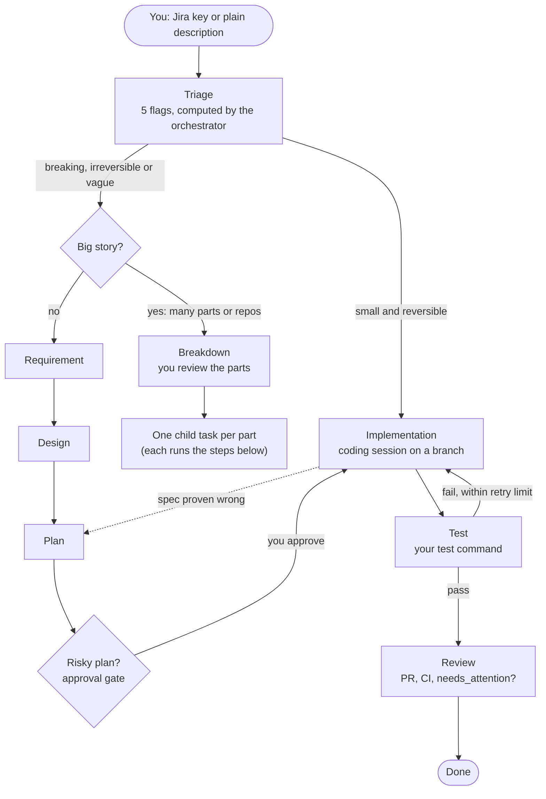

# The workflow

What happens to a story from the moment you describe it to the moment it is reviewed. For the machinery behind it see [architecture.md](architecture.md).

## At a glance

You are asked at three kinds of moments: to **answer open questions** in a requirement, to **confirm or revise** a stage document, and to **approve** a risky plan. Every reply from the orchestrator ends with numbered options, so there is nothing to memorise.

## 1. Intake and triage

You start by naming a repo and describing the work, or giving a Jira key (`start jira PROJ-123`). The orchestrator reads the ticket (if any) and sets five flags:

| Flag | Meaning |
|---|---|
| `files_affected` | A rough count of files or modules |
| `reversible` | False for migrations, schema changes, deletions |
| `breaking` | True if it touches a public API or another consumer's contract |
| `has_precedent` | A similar pattern probably exists in the repo |
| `requirement_clarity` | `high` if there are explicit acceptance criteria, `low` if vague |

The server decides the path: **heavy** = breaking, or not reversible, or low clarity. **Light** tasks start at implementation. **Heavy** tasks go through requirement, design and plan first. A **risky** task (breaking or irreversible) also needs your approval on the plan.

## 2. Big stories are split first

If the requirement looks big (many acceptance criteria, several independent deliverables, more than one PR, or several repos) the orchestrator runs **task-breakdown** and shows you a numbered list of parts: title, repo, and why each is independent.

- Nothing is created until you agree. The server enforces this: it refuses to create the parts until the breakdown is approved, and revising it voids the approval.
- Each part becomes its own **child task** with its own design, plan, approval gate, branch and PR.
- The parent is the overview. Ask for status and you get a table of parts with their stage and what each waits on, and "2 of 5 parts done". A parent is never called complete while a part is unfinished.
- If the parts must ship together, the parent is marked `coordinated_release` and the first parts wait for their siblings before finishing.

## 3. The analysis stages

For heavy tasks, each stage runs as a **read-only dispatch**:

| Stage | Produces | You do |
|---|---|---|
| **Requirement** | Problem statement, acceptance criteria, assumptions, **open questions** | Answer the open questions, then confirm or revise |
| **Design** | The chosen approach and the alternatives rejected | Confirm or revise |
| **Plan** | Ordered steps ("touch file X to do Y"), the files touched, a **test plan** | Review; approve if the gate applies |

Each document is a Markdown file you can read in any editor (`artifacts/<task>/<stage>.v<N>.md`). **Revising makes a new version** rather than overwriting, and the next stage reads the latest, including your edits. Documents are stamped with the skill version and platform that produced them.

The orchestrator never copies a document through the chat. It tells the server "store the result of dispatch X", and shows you a short summary.

## 4. The approval gate

A risky plan stops here. Implementation is refused until you say "approve the plan" and the server records it. If you revise the plan afterwards, the approval is void and you approve again. A gate can also be given an auto-approve timeout in `policy.json`; the orchestrator notifies you when it fires.

## 5. Implementation

A **coding dispatch** runs on its own branch (`story/<Jira key or task id>` by default, created from whatever is checked out, never `main`). It is given the plan, and the plan's file list becomes its **allowed scope**.

Optional **tests first**: a separate session writes the failing tests from the plan's Test Plan, the server confirms they fail for the right reason and freezes them, and the coding session must make them pass without editing them. It costs one extra session, so it is offered for bug fixes, logic and risky changes, and not for refactors, UI or docs.

When the session ends the server checks it (scope, frozen tests, branch) and the orchestrator reports what changed, including any files outside the plan.

## 6. Test, retry and review

The server runs your repo's test command (detected from `package.json`, `pom.xml`, `pyproject.toml` and so on, or set with `test_command`).

- **Pass:** the task moves to review.
- **Fail:** back to implementation with the failure output as instructions, up to `max_test_retries` (default 3). After that it goes to review flagged `needs_attention` so a human decides.

In review, the orchestrator finds the PR for the branch, reads CI and review comments, and reports. It never merges or pushes. Say "done" when you are satisfied.

**Optional independent AI review.** When the tests pass the orchestrator offers one more session: a read-only reviewer reads the diff of the task branch against `main` (or `base_branch`) and judges it against the requirement's acceptance criteria and the plan's steps and Test Plan. It runs on a **different platform or model than the coder** where one is configured (set `review_platform` in `config.json` to choose), and the result says whether it really was independent. The review is a document with a verdict (`approve` or `changes-requested`), findings with severity and evidence, plan compliance and test coverage. It is advice: you decide whether to send the task back to implementation with the findings. Very large diffs are cut at whole files and the reviewer is told which it did not get.

## 7. When the spec is wrong

If a coding session finds that the plan, design or requirement itself cannot be implemented as written, it says so instead of working around it. The orchestrator sends the task **back to that stage** with the problem as an open question, you answer it, and the revised plan needs approval again. A task can be sent back twice by default; after that the orchestrator asks you how to proceed.

## 8. While a session is running

Stages take roughly 1 to 5 minutes (coding can take longer). The orchestrator waits for the session and tells you how long it has run and what the worker last printed. If a session looks stalled (about 10 minutes running, or 5 minutes without output) it offers: keep waiting, **cancel and retry**, or retry on another platform. It never cancels on its own. A session that passes `dispatch_timeout_minutes` is stopped and reported as failed.

## 9. Coming back later

`what's open?` lists unfinished stories across your registered repos, numbered. `continue 2`, `resume PROJ-123`, a PR number or a task id all resume a story, and show where it is, what was decided, and what it is waiting on.

You can also inspect a story from a terminal without the chat: `node dist/cli.js tasks show <task>`.

## Who does what

| Step | Orchestrator | Server | Worker AI | You |
|---|---|---|---|---|
| Triage | Computes flags | Picks heavy or light | | Describe the story |
| Analysis stages | Chooses and starts | Builds prompt, checks read-only, stores the document | Reads the repo, writes the document | Answer questions, confirm |
| Gate | Asks you | Blocks until approved | | Approve |
| Implementation | Starts, reports | Branch, scope and frozen-test checks | Writes the code | Review the result |
| Test | Runs and reports | Runs the command, counts retries | | Decide when it needs attention |
| Review | Finds the PR and CI | | | Merge it yourself |
